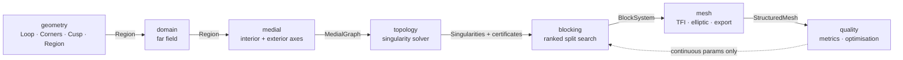

# AeroMesh — Architecture and Build Order

Companion documents: [PROJECT_TRACKER.md](PROJECT_TRACKER.md) for live status
and the decision log, [MAPS_Proposal_v2.md](MAPS_Proposal_v2.md) for the
scientific argument, [MAPS_Implementation_Plan.md](MAPS_Implementation_Plan.md)
for stage-by-stage detail.

**Revised 2026-09-08** after a full review of the first iteration. What changed
and why is in the Decision log of the tracker (D1–D7); the short version is at
the end of this file.

---

## The governing rule

> [!IMPORTANT]
> **Nothing is prescribed.** No hardcoded topology, no domain-type switch, no
> rule table, no per-airfoil or per-configuration branch.
>
> **Derived:** the number of blocks, their connectivity, which boundary arc
> belongs to which block, the number and position of interfaces, the positions
> and types *k* of every singularity, the vertex classification, and the
> topology class itself.
>
> **Supplied:** the geometry of the bodies, where the domain is truncated (a
> distance, or an explicit outer curve), and the target resolution — which
> follows from Re, y⁺ and altitude.

Anything in the first list that is currently an input is a defect. Anything in
the second is a modelling choice, not a topology decision.

The single prescribed construction permitted anywhere is the
midpoint-subdivision template for filling a logically convex *m*-gon (Stage S3).
That is a proven primitive for quad-meshing an *m*-gon — at the level of a
quadratic formula, containing no geometry-specific case — and it must be named
as such where it is used, so it is not mistaken for the thing that was removed.

---

## The data model

A **`Region`** is one outer loop and any number of inner loops. That is the
whole input.

```
Region
├── outer : BoundaryLoop          the truncation curve
└── holes : (BoundaryLoop, ...)   the bodies, any number
```

Each `BoundaryLoop` carries its `Loop` (closed, CCW, uniformly resampled) and
its resolved `Corners` — detected from the geometry, plus any created by opening
a cusp, which are known exactly rather than detected.

This is TopMaker\'s own input model: *a collection of non-intersecting closed
curves*. It subsumes single airfoils, multi-element sections and wing–body
crossflow cuts, and it is why multi-body support costs nothing later.

**There is no `DomainType`.** C, O and H are labels read off the resulting block
graph, never inputs. See D2.

---

## Modules



### `aeromesh.geometry` — the primitives ✅ built

| Module | Contents |
|---|---|
| `loop.py` | `Loop`: closed, CCW, stored open. Arc-length interpolation and corner-preserving resampling, area centroid, containment, rigid transforms. |
| `corners.py` | Scale-invariant C0 detection: extrapolate total turning to zero window width. Returns the corner angle. `fluid_interior_angle` handles the hole/outer convention. |
| `cusp.py` | `open_cusp` cuts perpendicular to the cusp axis and inserts a face of exact length. `find_cusps` gates it. |
| `region.py` | `Region`, `BoundaryLoop`, `prepare_boundary`, `largest_inscribed_circle`. |
| `airfoil.py` | The only module importing AeroShape. Returns a `Loop`, applies no TE policy. |

Why total turning rather than a turn angle over a stencil: for a smooth arc,
turning is exactly linear in the window width, so the extrapolation is exact.
A chord-angle measure saturates at high curvature and reports a NACA leading
edge as a 26° corner — which is precisely the false positive that has to be
avoided.

### `aeromesh.domain` — where to truncate ✅ built

The conventional truncation curves, as explicit constructors. Every one returns
a plain `Loop`.

| Constructor | Corners | Conventional name |
|---|---|---|
| `circle_farfield(bodies, radius)` | 0 | O-type — **the default** |
| `c_farfield(bodies, radius, wake_length)` | 2 | C-type |
| `box_farfield(bodies, upstream, downstream, lateral)` | 4 | H-type, or tunnel walls |
| `offset_farfield(bodies, distance)` | 0 | a distance level set — for tight or widely spread configurations |

**The shape is supplied; the topology is derived.** These are two different
statements and both matter.

*Supplied*: which curve, like how far out to truncate, is a modelling decision.
A circle is geometry, not prescription.

*Derived*: the shape is passed as a curve and stored as a curve. `Region`
records no shape, kind or family, so no later stage can branch on which
constructor made it — an unnamed hand-built curve works identically. Choosing a
C-shaped outer boundary does not select a "C topology".

What the choice *does* influence is how many corners the fluid boundary has, and
a corner generates a medial flare, and a flare generates a block. *Measured* on
a NACA 2412: circle 0 flares, C-shape 2 (the downstream pair; its arc joins the
straight sides tangentially), box 4. That is the mechanism behind the familiar
ring-plus-four-blocks topology, and it is why the default must not be
corner-free by accident. See D8.

`offset_farfield` keeps its place for tight domains and widely spread bodies,
where a circle large enough to contain everything wastes cells. Note that
offsetting a union of *separated* bodies leaves a concave crease where the
nearest-body branch switches — a real corner from an arbitrary choice — so it
offsets the convex hull by default (`hull=True`). Measured on a main-plus-flap
pair at 3 chords: a −20.9° crease with `hull=False`, none with the default.

### `aeromesh.medial` — the two skeletons ✅ built

Two entry points, `interior_axis(loop)` and `exterior_axis(region)`, both
returning a graph carrying **r_m, θ_m, n̂₁, n̂₂, touch points and arc length s**
on every medial point. The first iteration computed none of these, which is why
the topology stage had nothing but node degree to work with.

**Why two.** The exterior axis of a far-field domain is scale-dominated: with the
boundary at ten chords, θ_m over the whole medial loop measures 172.9°–180.0°,
so Fogg's index n = round((π − θ_m)/(π/2)) is zero everywhere. The loop is
featureless. The body's *interior* axis is scale-free and carries the shape:
θ_m ≈ 70° at the leading-edge dangle (n = 1, a nose singularity) against 180° at
mid-chord (n = 0), identically for 0012, 2412 and 8412.

**Membership is geometric, and the unit is the smooth boundary element, not the
loop.** A ridge is medial when its generators lie on different elements, or far
enough apart on the same one. A C0 corner divides a loop into elements, so
`Region.segment_ids()` derives the segmentation from detected geometry. That is
the same idea the first iteration reached for with its upper/lower "macro
curves" — but split at the minimum-x sample, a parameterisation artefact, which
is what invented a branch of radius zero at every leading edge.

**Accuracy comes from measuring to the polyline, not to the samples.** Both
r_m and the touch points are exact feet on the boundary segments, which makes
θ_m second order; a flare tip additionally takes θ_m = π − α analytically from
the corner angle, because there both touch points converge and the measurement
is decided by the last surviving Voronoi vertex. Against closed form: annulus
r_m to 0.0021% and θ_m to 180.000°, ellipse half-extent to 0.046%, θ on a 90°
flare exactly 90.0000° across a 5000× range of scales.

**Finite contact is built deliberately.** An exact circle's medial axis is a
single point and a discrete Voronoi returns an empty graph. The vertex is
emitted explicitly with its max θ_m = 180°, which is what Fogg's
k = −⌊max θ_m/(π/2)⌋ = −2 consumes.

**No wake branch, and that is correct.** The medial axis terminates at convex
corners of the *fluid domain* — the far-field corners, which give flares. A
convex corner of a *body* is reflex for the fluid, where the corner is the
unique nearest point for a fan of directions, so nothing emanates. A circular
far field around an airfoil gives a bare ring. The wake cut is a decomposition
split from a reflex corner (Fogg §4.1), which is S3. See D9.

### `aeromesh.topology` — solve, do not look up ⬜ S2

The singularity field is the **solution** of a flux balance, evaluated only at
the three positions where an imbalance can occur (Fogg §3.5): θ_m crossings of
π/4 and 3π/4, medial vertices, and concave-corner switch points. At finite
contact, k = −⌊max θ_m/(π/2)⌋; at boundary corners, n_c from the fluid interior
angle. Nearby singularities merge within a **local** tolerance of [r_m/4, r_m],
so a fuselage and an airfoil in one domain each get their own scale.

TopMaker\'s rule table — primary edge gives two block faces, flare one, dangle
five — is **not implemented**. Fogg\'s paper exists because it fails: it assumes
all corners are flat except those on flares, which distorts blocks on a
multi-element aerofoil. See D3.

**Two certificates, both cheap, both before construction.**

- *Retract*: b₁ of the medial graph must equal the number of bodies, because the
  medial axis deformation-retracts onto the fluid region. Measured exact across
  one, two and three bodies, an airfoil-plus-fuselage pair, a lone fuselage and
  a circle.
- *Index budget*: Σkᵢ constrained by χ = 1 − h, as a cross field on a surface
  must satisfy Gauss–Bonnet. It scales with body count for free. The annulus case
  is a first confirmation — χ = 0, budget zero, n = 0 measured everywhere.
  Pinning the exact constant per boundary convention is real work.

### `aeromesh.blocking` — solve, search, build ✅ S3

Three layers, in the order they run.

**`splits`** — the decomposition splits. A split is a curve of the medial
coordinate system, never a hand-placed polyline: a constant-s split is a medial
radius pair running T₁ → p(s) → T₂, and because a medial radius meets the
boundary perpendicularly by definition, **it is orthogonal to the wall at both
ends by construction** — verified against the boundary polyline, worst |cos|
under 0.08. Candidates are ranked as Fogg ranks them: n = 0 before n = 1, and
within a class the medial angle nearer the ideal.

**`search`** — where the cuts go. On a medial edge carrying singularities at
s₁ < … < s_k, one cut per gap: (0, s₁), (s₁, s₂), …, (s_k, L). That separates
the k singularities into k spans and leaves the outer cuts bounding the vertex
regions. The objective, and it is checkable, is that **each block holds at most
one singularity**.

A flare is the exception and is left uncut. Along a flare θ_m is *exactly*
π − α and r_m is *exactly* linear in arc length, so every candidate ranks the
same and the wedge a cut leaves is a scaled copy of itself wherever it goes —
no local criterion can exist. Fogg marks such a corner *resolved*, so the wedge
merges into the neighbouring vertex region.

**`blocks`** — the blocks themselves, constructively from the medial graph
rather than by computing a planar arrangement: a span between two cuts is a
four-sided block, a medial vertex is an m-sided region, a loop with no vertices
is a ring wrapping on itself. Blocks are wound counter-clockwise and carry
connectivity — every side is either on the region boundary or shared with
exactly one other block, traversed oppositely by the two. That is what lets S4
match point counts across an interface.

Validation is deliberately layered, because an area sum is weak: it cannot see
an overlap cancelled by an equal gap, and it cannot see a zero-area spike at
all. `validate` checks joins, stray vertices and degeneracy; `validate_strict`
adds shapely self-intersection and measures overlap, gap and spill separately;
`interface_report` checks conformality — and a side that pairs with nothing is
not allowed to pass as a boundary side, which the earlier count could not see
because `paired + boundary == n_sides` is a tautology.

**`index_certificate`** is the sharpest of the four, and it checks the
*product*, not a prediction. For any quadrilateral mesh

    Σ_interior (valence − 4) = Σ_boundary (2 − q) − 4χ,

which is Euler's formula rearranged, so it holds identically — which makes it
useless as a forecast and valuable as a consistency test of the blocking's own
bookkeeping. Read off the blocks: an m-gon meshed by midpoint subdivision puts
one node of valence m at its centre, a point where q blocks meet has q quads
around it, a ring contributes nothing. It resolves what an area test cannot: the
crack it found between two vertex regions on a fuselage-plus-wing was 5e-7 of
the region area, below the 1e-6 the shapely check uses, and it was a real hole.

`canonicalise` exists because `n_sides` has to be the *logical* degree and was
not. Two boundary arcs of a vertex region meet at the medial vertex's shared
touch at exactly 180°, on smooth wall, with nobody else having a corner there —
eight such joins out of 23 block corners on one blocking, which reported
`[8,8,8,7]` for logical `[5,6,5,5]`. Everything downstream reads `n_sides` as the
degree, so a spurious side is a spurious unit of index and a 180° one-quad cell
on the wall.

`design_index` is the companion: what the blocking *asks for*, from its corner
angles, `Σ(2 − round(θ/90°)) − 4` per block. It agrees with the singularity
field's budget where midpoint subdivision does not, and the difference —
`quality()["design_gap"]` — localises to the unresolved reflex corners.

**`layers`** — the other family of medial curves. A constant-s curve is a
medial radius pair; a **constant-ρ** curve is the offset
C(s) = T(s) + ρ·(p(s) − T(s)), the outer edge of a near-wall block.

The thickness law is `δ(s) = min(δ_target, ρ_max·r_m(s))`. Constant ρ alone is
the coordinate working correctly and the wrong law: near-uniform along a lone
body (1.4× over a chord) and collapsing 37× in a flap slot, because a boundary
layer's thickness is set by the flow, not by how much room there happens to be —
it must merely *fit*. The medial term is the ceiling that makes it fit, and
ρ_max becomes the safety margin while remaining the quantity S6 varies. The cap
has to cap *pointwise*: smoothing the radius field raises it exactly where it is
the only thing preventing a collision, 12.5× in a slot, so the smoothed field is
clipped back to the raw one. That restores a real guarantee — δ < r_m pointwise
is **sufficient** for the offset to be simple, since a crossing would put a
point strictly inside a maximal inscribed disc.

`insert_layer` puts the layer in as a **split of the blocking**, not as a new
region to decompose. Peeling and re-deriving was the wrong order of operations:
the offset curve carries enough small-scale structure to grow medial branches of
its own (4 blocks → 15), and smoothing the curve is worse, because averaging a
curve shortens it and drags the offset onto the wall (wall distance 1.5× → 66×).
Splitting inherits the topology instead of recomputing it, and the split is
exact — a medial radius meets the wall at a right angle and a constant-ρ curve
is parallel to it, so the offset crosses a cut at the point reached by travelling
δ along it from its wall foot, an arc-length step with no tolerance in it. No
singularity is created: four blocks meet at each crossing, so the node is
regular and the certificate is unchanged.

Trimming is a property of the **cut**, not of the block. The wake region of a C
far field meets the wall only at the trailing-edge *point*, so it has no wall
side; driving the trim from "this block has a wall run" left its cuts full
length while its neighbours trimmed theirs, and it overlapped their layer by
2e-8 of the region — two orders below the tiling check, and caught by the
certificate. A block touching the wall at a point still gets its share of the
band: the curve at distance δ from a point is a circular arc.

**`templates`** — m-gons into quadrilaterals, by midpoint subdivision. This is
the one prescribed construction the method allows and it is named as such.

It must be applied to **every** block: subdivision splits each side at its
midpoint, so a quad left whole beside a subdivided neighbour carries a node in
the middle of a side the neighbour runs straight past. All or nothing, and the
system comes back untouched with the reason in `notes` if any block would fold.

Straight spokes to a centre fold at *any* centre — the area centroid of a layer
strip landed exactly on one of its own corners, the inscribed-circle centre is
interior by construction but the straight lines to it still leave a vertex
region wrapping a quarter of the domain, and even a four-sided span around half
an aerofoil folded. 5 of 8 blocks. The construction that cannot fold is
**Tutte's**: a discrete harmonic map of a triangulated disc onto a convex region
is injective, so the block is triangulated, its boundary sent to the unit circle
by arc length, the Laplace system solved, the spokes taken as straight radii
there and mapped back. Note Tutte constrains the *target*, not the source, so a
strongly re-entrant block is handled rather than rejected. Triangle must be told
(`Y`) not to insert Steiner points on the boundary — otherwise they get no
Dirichlet value, are solved as free, the boundary map stops being a
homeomorphism and the guarantee evaporates, which is why refining the spokes had
not converged (10, 8, 4, 7 folds out of 42).

Still open, with the diagnosis recorded in the tracker: the reflex
trailing-edge corner (two grid lines wanted, the outer one necessarily outside
the medial normal cone by 2.7°, and the two corners' downstream rays crossing
0.021 chord behind the trailing edge), and the predictor's residual.

### `aeromesh.mesh` — construction ⬜ S4

TFI per block, then Thompson–Thames–Mastin elliptic smoothing with wall spacing
imposed as a boundary condition, tanh clustering from Δy₁, r and N_wall, export
through `meshio`. Both algorithms are classical and both references are in
`PAPER/references`. The current `algebraic.py` returns zero arrays and
`smoothing.py` returns its input.

### `aeromesh.quality` — metrics and optimisation ⬜ S6

Wall orthogonality, minimum Jacobian, boundary-layer aspect ratio, metric jump
across interfaces, achieved y⁺; cross-checked against `vtkMeshQuality`.

The design vector is no longer degenerate. Interface arc-lengths sᵢ along the
exterior loop have no gradient (θ_m is flat there); the ring offset ρ* does. What
remains is a handful of smooth continuous parameters — ρ*, Δy₁, r, N_wall — which
is L-BFGS territory in tens of evaluations, not CMA-ES over a thousand.

---

## Build order

Full detail, gates and estimates in [PROJECT_TRACKER.md](PROJECT_TRACKER.md).

| Stage | Scope | Status |
|---|---|---|
| **S0** | Loop, corners, cusp policy, Region, far field | ✅ done 2026-09-08 |
| **S1** | Medial engine | ✅ done 2026-09-08 |
| **S2** | Singularity solver and certificates | ⚠️ mostly done |
| **S3** | Decomposition | 🔨 conformal blocking |
| **S4** | Mesh construction | ⬜ |
| **S5** | Adversarial geometry gate | ⬜ |
| **S6** | Quality and optimisation | ⬜ |
| **S7** | Bunin φ-field by FEM — optional | ⬜ |

> [!WARNING]
> **S0 → S1 → S2 → S3 is not negotiable.** The hardcoded blocking in the first
> iteration appeared because S3 was attempted while S1 was incomplete and S2 did
> not exist. If the singularity solver cannot yet tell an O-topology from a
> C-topology on a bare skeleton, the decomposition stage has nothing to
> decompose against and a template is the only thing that will run.

---

## What changed in this revision

| Was | Now | Why |
|---|---|---|
| `Boundary` (one airfoil) + `DomainType` (C/O/H) | `Region` = outer loop + N holes | C/O/H were an input that switched the blocking — prescription at the top of the pipeline. Multi-body becomes free. **D2** |
| Closed TE only; blunt TE out of scope | Blunt is the default; closed and cusped supported by explicit corner seeding | A cusp is the degenerate case for a medial axis and the wake branch cannot be recovered from a Voronoi. **Reverses the earlier decision. D1** |
| TopMaker rules as the blocking method | Flux balance solves; a ranked search decomposes | The rule table is what Fogg\'s paper is a critique of. **D3** |
| Far field selected by letter, which also switched the blocking | Far field is a curve, built by an explicit constructor; circle by default | Separates the two things the letter used to do. The curve is a supplied modelling input; the topology is derived from its corners. **D4, superseded by D8** |
| Phase D: physics-informed DeepONet | Cut from the critical path; Bunin φ kept as an optional FEM stage | Topology is solved and certified rather than searched, so the surrogate is a fast answer to a problem that no longer exists. **D5** |
| Phase A marked *done* and *strictly validated* | S0 done; the rest open | θ_m, n̂, the touch-point map and angle-based pruning did not exist. The suite passed 34 shape assertions while the skeleton carried branches of radius zero. **D6** |

---

## Reuse from AeroShape

| Need | API | Used in |
|---|---|---|
| Airfoil points | `AirfoilProfile.from_naca4/5/cst/parsec/dat_file` | `geometry/airfoil.py` |
| Wall-normal clustering | `aeroshape.analysis.clustering` | S4 |
| CST random sections | `AirfoilProfile.from_cst` | S5 randomised gate |
| B-spline basis | `geomdl` / AeroShape NURBS | 3-D extension |

The dependency is one-directional and confined to a single module. AeroMesh
re-implements no geometry handling.
